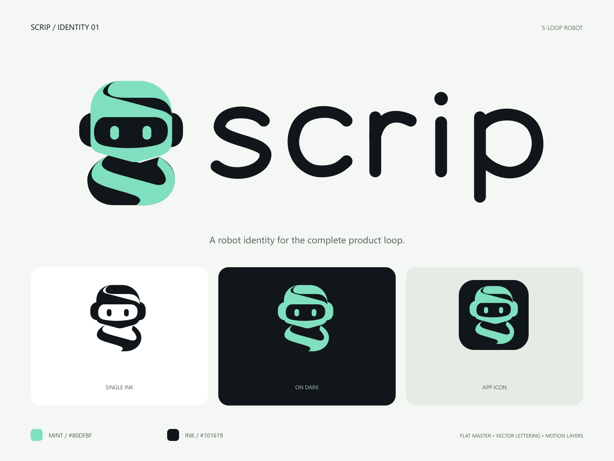

# Scrip identity — S-loop robot, v1

The [v2 S logo](v2/README.md) is for product branding and logo placements. The original
mint robot below remains the mascot for the homepage artwork and character animation.
The two assets have distinct roles; do not substitute the S logo for the robot. Robot
animation assets and instructions live in [motion/](motion/README.md).



An S-shaped working companion for the complete product loop: building, coordinating,
improving, and shipping. The character represents Scrip itself rather than a specific
model, IDE, approval button, or vendor. Platform support and product capabilities remain
separate engineering claims; the identity does not establish compatibility.

The flowing helmet fold and lower S ribbon create the shared visual signature. The calm
two-eye face supplies expression without turning the mark into a detailed illustration.
Keep those features consistent when extending it into a mascot or 3D character.

## Asset selection

| Asset | Use |
| --- | --- |
| `scrip-symbol-v1.svg` | Editable full-color primary symbol; master geometry |
| `scrip-wordmark-v1.svg` | Custom vector lowercase lettering; master geometry |
| `scrip-lockup-v1.svg` | Symbol plus wordmark on a light surface |
| `scrip-lockup-white-v1.svg` | Single-color lockup for a dark surface |
| `scrip-symbol-ink-v1.svg` | Single ink, printing, engraving, and light backgrounds |
| `scrip-symbol-mint-v1.svg` | Single mint symbol on ink backgrounds |
| `scrip-symbol-white-v1.svg` | Single white symbol on dark backgrounds |
| `scrip-app-icon-v1.svg` | Rounded ink tile with the mint reduction |
| `icons/scrip-icon-{size}.png` | 16, 24, 32, 64, 128, 256, and 512 px app exports |
| `scrip-brand-board-v1.svg` | Editable presentation sheet; labels use system-font fallbacks |
| `scrip-mascot-reference-v1.png` | AI-generated 3D appearance reference, not a mesh or rig |

Transparent PNG exports accompany the SVG symbols and lockups. The primary symbol contains
only solid mint and ink fills. SVGs contain editable geometry, not an embedded bitmap.
The wordmark is custom vector lettering and requires no installed font. Presentation labels
are not part of the logo and may use a system-font fallback.

`concepts/scrip-robot-concept-v1.png` is the initial AI concept. It is retained as design
provenance, not the production master. Exact generation prompts are in [PROMPTS.md](PROMPTS.md).

## Color and use

| Color | Hex | Role |
| --- | --- | --- |
| Mint | `#80DFBF` | Main shell and positive motion accents |
| Ink | `#101619` | Visor, core, wordmark, and app background |
| White | `#FFFFFF` | Reversed single-color mark |
| Mist | `#F4F7F3` | Optional presentation surface; not a required logo background |

Use the full-color mark on a light, quiet surface, or the single mint/white version on ink.
Keep at least one eye-width of clear space outside the visible silhouette. Preserve the
SVG's aspect ratio and the lockup's spacing. Prefer at least 32 px for the full symbol in
interfaces; use the app reduction for smaller launcher/favicon uses and inspect its actual
target size. No raster asset remains sharp at unlimited sizes; use the SVG when scaling.

Do not add checkmarks, shields, IDE badges, vendor marks, circuitry, gradients, or new
decorative details to the flat master. Do not stretch the mark, recolor individual pieces,
or place the detailed 3D render in tiny navigation/toolbar slots. The app-icon carrier is
an application asset, not an extra frame required around every logo use.

## Motion foundation

The primary SVG has named layers: `body`, `body-core`, `body-loop`, `head`, `helmet`,
`s-fold`, `visor`, `eyes`, `eye-left`, `eye-right`, and side pods. Use these as the source
for animation imports; keep the original master unchanged and create a versioned derivative.

- **Ready:** still silhouette, level eyes, a quiet blink around every 5–7 seconds.
- **Working:** a restrained 2–3 px vertical settle and a small head tilt; keep the S visible.
- **Attention:** a short eye squeeze and return to level, without frantic flashing.
- **Shipped:** one confident nod/settle, then rest; no approval/checkmark emblem.

Suggested starting timings: 100–140 ms for the closed part of a blink and 200–320 ms for a
small transition. Keep motion subtle in work interfaces and provide a reduced-motion state.
These are art-direction suggestions, not implemented product statuses or shipped animation.

## 3D and mascot handoff

Use the front SVG as the silhouette authority. Extrude the existing forms; keep the helmet
fold, two pill eyes, side pods, and lower S ribbon. Start with a soft matte mint shell and
satin ink visor/core. Separate head, eyes, pods, and body for rigging. Use shallow bevels
that preserve the flat silhouette when seen front-on. Preserve facial spacing across poses.

The supplied 3D image illustrates materials and volume. It is not dimensionally exact,
does not define hidden/back geometry, and is not a finished 3D asset. Model sheets, back/side
views, topology, rigging, mobile-safe-area checks, and final animation exports are future work.

## Regenerate exports

Edit only the two master SVG files, then run from the repository root:

```sh
uv sync --locked --extra desktop
uv run --extra desktop python -m devtools.export_brand
```

The exporter derives single-color marks, lockups, app icons, and the presentation sheet.
It does not change the source masters or the generated mascot reference. Keep a new `v2`
family for a substantially different identity rather than silently changing a selected v1.
