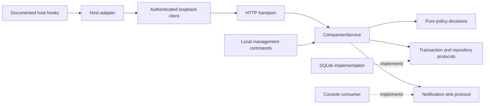

# Architecture

Scrip is a local application with an explicit event and policy boundary. The package is
small enough to run as one process. Its boundaries allow infrastructure changes when a
measured requirement justifies them; they do not imply distributed-system readiness.

## Dependencies

`models.py` and `policy.py` contain the event contract and deterministic permission logic.
`service.py` owns event processing, deduplication behavior, lifecycle handling, and delivery
coordination. It imports no SQLite, HTTP framework, or host schema. `ports.py` defines the
interfaces it actually uses. `bootstrap.py` composes the service with SQLite.

`storage/` owns SQL, row validation, connection lifetimes, and forward migrations. `records.py`
contains application result types so neither the API nor the service depends on SQL rows.
`api.py` validates/authenticates transport requests and maps application errors to HTTP.
`cli.py` parses commands; `commands.py` delegates to the service or local client.

Adapters share stable hashing, command quoting, question parsing, and capability contracts.
Each host module retains its own lifecycle and permission semantics. Register a built-in
adapter explicitly in `adapters/registry.py`; there is no dynamic plugin loader. An adapter
must not import another host adapter to reuse mechanics.

## Event transaction

An ingestion transaction expires pending requests, checks an event fingerprint, verifies
session/workspace identity, evaluates policy, updates state, creates any inbox/outbox records,
and saves the event and result atomically. Errors roll the whole transaction back.

Event identity is global. Reusing an ID with changed semantic content conflicts. Identical
retries reuse the stored result, except a previously emitted enforcing approval becomes
`ask`: automatic approval is emitted at most once for that event ID. Changing an operation
ID or arguments under the same event ID cannot obtain a fresh decision.

Rules match full structured arguments plus adapter, absolute workspace, exact tool, optional
session, expiry, and enabled state. No repository text or model response installs rules.
A deny rule wins; pause suppresses automatic approvals. Exact arguments do not establish
that the underlying project code is safe. Users remain responsible for the rules they add.

Input requests are distinct from execution permissions. Tool completion resolves only the
matching adapter/session/operation. Turn completion closes pending requests and leaves a
conversation idle; session completion closes it until an explicit session start. Requests
expire after 15 minutes by default. Acknowledgement is local and never forwards an answer.

## Persistence and delivery

SQLite uses WAL, per-operation connections, a bounded busy timeout, and short explicit
transactions. Writes use `BEGIN IMMEDIATE`; read-only history/rule/status operations use
read transactions. Schema migrations and version changes commit together. A database from
a newer schema version is refused. Back up private state before upgrading; downgrade and
migration rollback tooling are not provided.

Indexes cover request expiry/session/operation, scoped rules, recent sessions/history, and
notification delivery. Inbox, sessions, notifications, and history responses are bounded to
100 items; these are recent-item views, not a complete pagination/export interface. Rules
are local trusted configuration and are currently listed in full.

Notification consumers claim a bounded batch with a token and a 30-second lease, commit,
then perform external I/O outside the transaction. Completion updates require the current
lease token. Concurrent consumers cannot claim an active lease. Expired leases can be
reclaimed after a crash. Resolved or dismissed requests cancel queued/in-flight records.

Delivery is **at least once**: a crash after sending but before committing, or a slow consumer
outliving its lease, can produce a duplicate. Sinks should deduplicate by notification ID.
An already in-flight alert may still arrive after dismissal. Failed sends store only the
exception type and become terminal `failed` records; automatic retry/backoff is not yet
implemented. The console consumer is the only delivery implementation today.

SQLite remains a single-writer local store. There is no claim of unlimited scale, load-tested
throughput, multi-user tenancy, retention management, or remote coordination. Benchmark event
volume and database growth before choosing additional indexes, retention, or another storage
backend. Keep a replacement behind the existing transaction contract when one is needed.

## Trust and compatibility

The CLI binds HTTP to `127.0.0.1`; requests require a local token. Browser-origin requests,
non-local Host headers, redirects, and oversized bodies are rejected. The token grants access
to local events/inbox and must remain private. This is not a security boundary against other
processes running as the same OS user. Local management commands can change rules and pause.

Hook adapters default to observation. Enforcing mode translates decisions through each host's
native protocol and returns to native review if the core is unavailable. Question tools use
the native question flow. Antigravity routing currently requires one workspace root; Claude
Code assumes a fixed working directory per session. Tool IDs are stable; lifecycle callbacks
without source event IDs are not guaranteed to deduplicate.

Tests exercise fixtures and real Scrip subprocesses over loopback, not installed host apps.
A live adapter release needs a documented host version/platform matrix and isolated
integration testing. No vendor files, internal commands, or automatic host installation are
part of this architecture.
